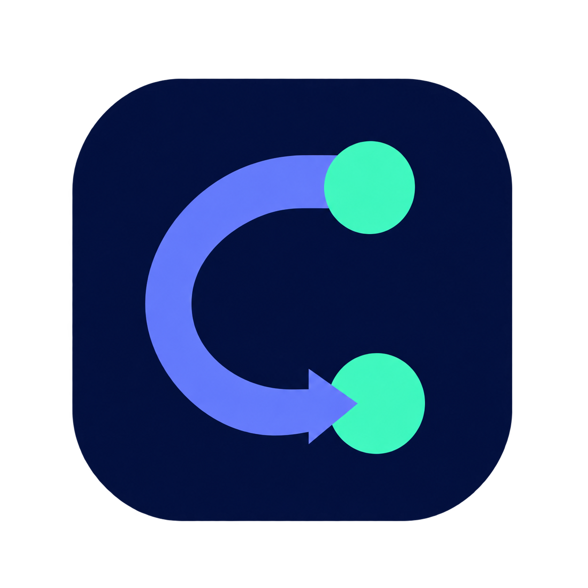

<p align="center">
  
</p>

<h1 align="center">CineRelay · 映桥</h1>

<p align="center">A cache-first movie metadata relay for VidAll, backed by TMDB.</p>

CineRelay 是为 [VidAll](https://github.com/yaoshining/vidall-tv) 设计的影视元数据中转站。VidAll 先查 CineRelay 的 Postgres；命中有效缓存时直接返回，只有首次缺失、缓存过期或后台同步命中变更时才请求 TMDB。多个 VidAll 客户端可以复用同一份数据，不必各自回源。

> 项目当前处于设计阶段。本仓库只有文档和品牌素材，尚未实现 API、同步任务或部署，也没有发布 TMDB 数据集。

## VidAll 怎么接入

```text
VidAll → CineRelay → Postgres
             │         ↑
             └→ TMDB ──┘
           缺失时回源，成功后写回
```

1. VidAll 传入电影 TMDB ID 和语言，例如 `GET /v1/movies/12345?lang=zh-CN`。路径为拟议接口，尚未上线。
2. **命中**：返回尚未过期的本地记录，不调用 TMDB。
3. **缺失**：服务端合并同一 ID、同一语言的并发回源，用服务端凭据请求 TMDB，写入 Postgres，再返回给 VidAll。
4. **过期**：后台刷新。若上游临时不可用，只在允许的保留期限内返回带过期标记的旧值；没有旧值时返回可重试错误，不把限流或故障当成下架。

首版以电影详情为主，按需支持 `zh-CN` 和 `en-US`。不做开放透传代理、全站搜索、剧集同步或海报镜像。TMDB 凭据只保存在服务端，不发给 VidAll 或写入 Git。

## 数据怎么同步

| 任务 | 计划 |
| --- | --- |
| **初始化** | UTC 08:00 之后获取 [Daily ID Exports](https://developer.themoviedb.org/docs/daily-id-exports)。文件是有效 ID 清单，不是详情库。按 MVP 范围分批拉电影详情，保存进度，允许中断续跑。 |
| **增量更新** | 分页读 [`/movie/changes`](https://developer.themoviedb.org/reference/changes-movie-list)。查询窗口不超过 14 天，留重叠，去重后把 ID 写入持久任务队列，再拉当前详情。窗口完整入队后才推进游标，失败任务单独保留。 |
| **每日对账** | 比较已完整校验的清单和本地记录，找漏抓及疑似下架。已缓存 ID 从清单消失时先复核，确认后标记，不因一次缺失、下载错误或限流批量删除。 |
| **时效与重试** | 对 `429` 尊重可用的 `Retry-After`；对 `5xx` 和网络超时退避重试。评分和热度不依赖 Changes 保证实时性，有需要时只定期刷新热门条目。 |

## MVP 范围

- **Python + cron + Postgres**：Python 负责拉取与写回，cron 跑增量更新和对账，Postgres 保存电影、翻译、游标和待重试任务。按 `tmdb_id` 更新主记录，按 `(tmdb_id, locale)` 更新翻译。
- **字段**：先做标题、原文标题、简介、上映日期、类型和海报路径等基础元数据。CSV / Parquet 仅按需导出，不作为主库。
- **验收**：重复同步不产生重复记录；中断后能续跑；并发首次请求只回源一次；后续缓存命中不回源；`429`、`5xx` 或异常清单不触发误下架。

## 数据授权与署名

本仓库放代码、文档、Logo 和合成测试数据，**不提交 API 密钥、TMDB 原始响应、海报或数据快照**。实际缓存位于部署方的 Postgres。大量回填、长期保留、对外提供元数据或用于付费产品前，先核对适用的 TMDB 条款和授权范围，不假设开发者 API 等同于可再分发许可。部署后的应用应按 [TMDB 署名要求](https://developer.themoviedb.org/docs/faq) 在「关于」或「鸣谢」中使用获准标志与免责声明。

> This product uses the TMDB API but is not endorsed or certified by TMDB.
